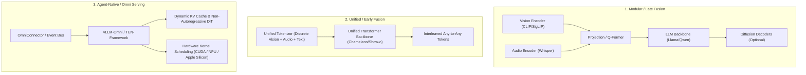

# 🌟 Awesome Multimodal AI Frameworks 🤖

**The Definitive Curated Directory of Any-to-Any Serving Runtimes, Vision-Language Models (VLMs), Omnimodal Orchestration & Agent-Native Execution Frameworks**

*Empowering AI researchers, systems engineers, and founders to build, deploy, and scale unified omnimodal models across text, vision, audio, video, robotics, and actions.*

---

## 📑 Table of Contents

- [🌐 Overview & Ecosystem Context](#-overview--ecosystem-context)
- [📊 Sector Overview & Market Dynamics](#-sector-overview--market-dynamics)
- [☁️ Leading Multimodal AI SaaS Platforms & APIs](#️-leading-multimodal-ai-saas-platforms--apis)
- [🚀 Top Open-Source Multimodal AI Frameworks](#-top-open-source-multimodal-ai-frameworks)
- [🧩 Multimodal Architectural Archetypes](#-multimodal-architectural-archetypes)
- [🛠️ How to Contribute](#️-how-to-contribute)
- [📈 Star History](#-star-history)
- [💖 Support & Community](#-support--community)
- [📜 License & Disclaimer](#-license--disclaimer)

---

## 🌐 Overview & Ecosystem Context

**Multimodal AI Frameworks** represent the cutting edge of artificial intelligence infrastructure. Moving decisively beyond single-modality text LLMs, these platforms and engines orchestrate, serve, and execute models that natively perceive, cross-reason, and synthesize information across **text, high-resolution imagery, streaming audio, continuous video, and physical robotic actions**.

Whether deploying cloud-scale omni-modality serving with sub-second time-to-first-token (TTFT) or orchestrating local agent harnesses across desktop GUIs and edge NPUs, this repository curates the leading production-grade tools, serving runtimes, and foundational open-source repositories.

---

## 📊 Sector Overview & Market Dynamics

The global **Multimodal AI market size** was valued at approximately **$1.85 billion in 2024** and is projected to expand to over **$14.2 billion by 2030**, compounding at an aggressive **CAGR of ~34.8%**. 

From a market structure perspective, the sector exhibits **bifurcated dynamics**:
1. **Foundation Model & Hyperscaler Layer**: **Highly concentrated oligopoly** characterized by winner-take-most economies of scale, massive compute capital expenditures ($10B+ clusters), and vertical cloud integration (Microsoft Azure, Google Cloud, AWS, OpenAI, Anthropic).
2. **Serving, Orchestration & Agent Harness Layer**: **Moderately to highly fragmented** and rapidly diversifying. Open-source inference engines (e.g., vLLM-Omni, LiteRT), robotics simulators (NVIDIA Cosmos), and modular edge runtimes (MiniCPM-V, TEN-Framework) compete actively across specialized hardware backends, latency budgets, and deployment surfaces.

---

## ☁️ Leading Multimodal AI SaaS Platforms & APIs

The following table benchmarks commercial cloud providers and managed SaaS APIs delivering enterprise multimodal inference and agentic pipelines, **sorted by company valuation / market capitalization (descending)**.

| Provider / Product 🏢 | Company Size (Valuation / Revenue) 💰 | Supported Modalities 👁️🎙️ | Starting Tier Pricing 🏷️ | Free Tier Limits 🎁 | Key Enterprise Strengths ⚡ |
| :--- | :--- | :--- | :--- | :--- | :--- |
| **[Microsoft Azure AI](https://azure.microsoft.com/en-us/solutions/ai/)** (Azure AI Foundry / OpenAI Service) | **$3.10 Trillion** Market Cap *(~$245B Annual Rev)* | Text, Vision, Audio, Speech, Video, Document Layout | **$0.150 / 1M input tokens & $0.600 / 1M output tokens** (GPT-4o mini); Batch API from **$0.075 / 1M input tokens** | **$200 free credit** for 30 days via Azure Free Account + **F0 Free Tier** (5,000 transactions/mo at 20 calls/min free forever for Vision & Speech) | Enterprise SOC2/HIPAA compliance, private VNet isolation, deep Microsoft 365 Copilot & Azure Databricks integration. |
| **[Google Cloud / AI Studio](https://aistudio.google.com/)** (Gemini 1.5 / 2.0 & Vertex AI) | **$2.15 Trillion** Market Cap *(~$307B Annual Rev)* | Text, Vision, Audio, Video (up to 2M tokens context), Code, Spatial | **$0.075 / 1M input tokens & $0.300 / 1M output tokens** (Gemini 1.5 Flash, prompts ≤128k); Gemini 2.0 Flash at **$0.10 / 1M input & $0.40 / 1M output** | **Free forever tier in Google AI Studio**: **15 RPM**, **1,000,000 TPM**, and **1,500 RPD** for Gemini 1.5/2.0 Flash; Vertex AI provides **$300 free trial credits** valid for 90 days | Industry-leading 2-million-token native multimodal context window; native video and audio stream parsing without pre-chunking. |
| **[Amazon AWS Bedrock](https://aws.amazon.com/bedrock/)** (Amazon Nova & Multi-Model Hub) | **$2.05 Trillion** Market Cap *(~$575B Annual Rev)* | Text, Vision, Video Generation, Audio, Multimodal Embeddings | **$0.035 / 1M input tokens & $0.140 / 1M output tokens** (Nova Micro); Nova Lite at **$0.060 / 1M input & $0.240 / 1M output** | **AWS Free Tier** includes **$300 credits for 12 months**; Bedrock trial grant provides **10,000 input tokens & 2,000 output tokens per month** for 2 months on select foundation models | Zero-data-retention guarantees, unified API abstraction over Anthropic, Meta, Mistral, and Amazon Nova models, AWS IAM security. |
| **[OpenAI](https://platform.openai.com/)** (GPT-4o, GPT-4o mini & Realtime API) | **$157 Billion** Valuation *(~$4.0B+ ARR)* | Text, Vision, Native Audio (Speech-to-Speech), Video Frame Streams | **$0.150 / 1M input tokens & $0.600 / 1M output tokens** (GPT-4o mini); GPT-4o at **$2.50 / 1M input & $10.00 / 1M output** ($0.006 per image input) | **Free ChatGPT Web/App Tier** (10–16 messages per 3 hours for GPT-4o, unlimited mini fallback); Developers receive **$5.00 free API test credit** valid for 90 days upon SMS verification | Low-latency Realtime Voice-to-Voice API over WebSockets, frontier reasoning benchmarks, gold standard function-calling ecosystem. |
| **[Anthropic](https://www.anthropic.com/)** (Claude 3.5 Sonnet & Claude 3.5 Haiku) | **$60 Billion** Valuation *(~$1.0B+ ARR)* | Text, Vision (High-Res Images, Charts, PDFs, UI Screenshots) | **$0.80 / 1M input tokens & $4.00 / 1M output tokens** (Claude 3.5 Haiku); Claude 3.5 Sonnet at **$3.00 / 1M input & $15.00 / 1M output** ($0.0048 per standard image) | **Free Claude.ai plan** with rolling window (~20–40 messages per 8 hours free forever); Anthropic Console provides **$5.00 free credit grant** valid for 14 days upon phone signup | SOTA coding and visual document reasoning; pioneered native "Computer Use" API for OS and desktop GUI automation. |
| **[Mistral AI](https://mistral.ai/)** (Pixtral 12B & Pixtral Large) | **$6.2 Billion** Valuation *(~$30M+ ARR)* | Text, High-Resolution Vision, Document OCR, Technical Diagram Parsing | **$0.150 / 1M input tokens & $0.150 / 1M output tokens** (Pixtral 12B via La Plateforme); Pixtral Large at **$2.00 / 1M input & $6.00 / 1M output** | **Free forever Le Chat tier** with Pixtral access; La Plateforme developer tier includes **free experiment endpoints at 1 req/sec** + **$5 free API credit** valid for 30 days | Flexible image resolution processing without arbitrary aspect-ratio distortion; Apache-2.0 open-weights licensing pathway. |
| **[Cohere](https://cohere.com/)** (Command R+ & Embed v3 Multimodal) | **$5.5 Billion** Valuation *(~$35M+ ARR)* | Text, Multimodal Cross-Modal Embeddings (Image + Text Semantic Retrieval) | **$0.100 / 1M tokens** (Embed v3 Multimodal); Command R at **$0.150 / 1M input tokens & $0.600 / 1M output tokens** | **Free Trial Developer Key**: **1,000 API calls/month** at **20 requests/minute** free forever for development and non-production testing | Specialized for enterprise search and Retrieval-Augmented Generation (RAG); enables unified semantic vector indexing across image catalogs and documentation. |

---

## 🚀 Top Open-Source Multimodal AI Frameworks

Curated open-source projects, serving runtimes, and foundation model libraries, **sorted by GitHub Stars count (descending)**. Every project includes a live star badge linking directly to its stargazers.

### 1. [OpenBMB / MiniCPM-V](https://github.com/OpenBMB/MiniCPM-V)  📱
- **Primary Focus**: On-Device Multimodal Large Language Models (See, Hear, and Speak)
- **Key Capabilities**: State-of-the-art vision-language understanding matching closed flagship models at 8B parameter scale. Supports real-time video streaming processing, bidirectional audio dialogue, end-to-end speech conversation, and high-density OCR. Deploys seamlessly on consumer MacBooks, mobile devices, and edge NPUs.
- **Modality Support**: Text, High-Res Images, Video Streams, Audio Speech.

### 2. [Microsoft / OmniParser](https://github.com/microsoft/OmniParser)  🖥️
- **Primary Focus**: Pure Vision-Based GUI Screen Parsing for Autonomous Agents
- **Key Capabilities**: Converts UI screenshots into structured actionable bounding boxes and semantic interactable elements without relying on underlying DOM or accessibility trees. Serves as the visual perceptual backbone for multi-surface OS and web automation agents.
- **Modality Support**: Screen Image Frames, Bounding Boxes, UI Coordinate Actions.

### 3. [haotian-liu / LLaVA](https://github.com/haotian-liu/LLaVA)  🔬
- **Primary Focus**: Foundational Visual Instruction Tuning & Open Multimodal Research
- **Key Capabilities**: The NeurIPS-celebrated standard for bridging visual encoders (CLIP / SigLIP) with autoregressive language backbones (Llama / Vicuna). Features extensive instruction-tuning datasets, benchmark suites, and training recipes widely adopted across academia and enterprise research.
- **Modality Support**: Text, Static Vision, Interleaved Dialogue.

### 4. [QwenLM / Qwen3-VL & Qwen-VL](https://github.com/QwenLM/Qwen3-VL)  🌏
- **Primary Focus**: Flagship Dynamic-Resolution Multimodal Foundation Model Family
- **Key Capabilities**: Dynamic resolution vision transformer supporting native aspect-ratio preservation, long-form video comprehension (over hours of footage), precise spatial grounding (bounding box 2D/3D output), advanced document parsing, and agentic UI operation.
- **Modality Support**: Text, Ultra-High-Res Vision, Long Video, Grounding Coordinates.

### 5. [NVIDIA / Cosmos](https://github.com/NVIDIA/cosmos)  🪐
- **Primary Focus**: World Foundation Models & Physical AI Simulation Framework
- **Key Capabilities**: Open platform developed by NVIDIA for Physical AI. Combines Diffusion and Autoregressive World Models with specialized physics-aware tokenizers to generate high-fidelity, physically consistent visual and action sequences for robotics training and autonomous vehicles.
- **Modality Support**: Video, 3D Worlds, Physics Dynamics, Robotic Actions, Text.

### 6. [Salesforce / LAVIS](https://github.com/salesforce/LAVIS)  📚
- **Primary Focus**: One-Stop Deep Learning Library for Vision & Language Intelligence
- **Key Capabilities**: Unified ecosystem unifying access to flagship multimodal models including BLIP, BLIP-2, InstructBLIP, and X-VLM. Simplifies multimodal pretraining, instruction tuning, evaluation benchmarking, and visual question answering (VQA) across diverse datasets.
- **Modality Support**: Text, Image-Text Retrieval, Captioning, Visual Reasoning.

### 7. [TEN-Framework / TEN-Agent](https://github.com/TEN-framework/ten-framework)  🗣️
- **Primary Focus**: Real-Time Conversational Voice AI & Multimodal Agent Architecture
- **Key Capabilities**: Modular runtime orchestrating real-time audio RTC pipelines, vision streaming, speech-to-speech interaction, and LLM reasoning. Achieves sub-200ms conversational turn-taking latency with support for hardware platforms (ESP32, edge boards) and multi-provider backends.
- **Modality Support**: Bidirectional Voice Audio, Video Feeds, Real-Time RTC Data.

### 8. [OpenGVLab / InternVL](https://github.com/OpenGVLab/InternVL)  🏆
- **Primary Focus**: Open-Source High-Capacity Alternative to Commercial VLMs
- **Key Capabilities**: Features a scaled 6B-parameter visual foundation model paired with dynamic high-resolution tile processing. Demonstrates state-of-the-art accuracy on multimodal math, document understanding, optical character recognition, and medical imaging benchmarks.
- **Modality Support**: Text, Multi-Image Assemblies, High-Res Documents, Video.

### 9. [vLLM Project / vLLM-Omni](https://github.com/vllm-project/vllm-omni)  ⚡
- **Primary Focus**: High-Throughput Serving Engine for Any-to-Any Omni-Modality Models
- **Key Capabilities**: Extends vLLM’s renowned PagedAttention and KV cache management to omnimodal generation. Features **Pipelined Stage Execution**, non-autoregressive parallel generation (Diffusion Transformers / DiT), and an **OmniConnector** layer for dynamic heterogeneous model orchestration across CUDA, ROCm, and NPUs.
- **Modality Support**: Text, Image, Audio Speech, Video, Diffusion Tensors, Action Tokens.

### 10. [OpenSenseNova / SenseNova-U1](https://github.com/OpenSenseNova/SenseNova-U1)  🎨
- **Primary Focus**: Native Unified Multimodal Architecture (NEO-unify Paradigm)
- **Key Capabilities**: Eliminates the architectural overhead of separate vision encoders and VAE decoders by modeling vision and language as a unified composite representation from the ground up. Unlocks continuous interleaved text-and-image generation within a single model forward pass.
- **Modality Support**: Interleaved Text-Image Generation, Unified Multimodal Understanding.

### 11. [zai-org / CogVLM](https://github.com/zai-org/CogVLM)  🧠
- **Primary Focus**: Deep Feature Fusion via Visual Expert Transformers
- **Key Capabilities**: Integrates visual expert modules directly into attention layers, enabling deep visual-linguistic feature interaction without degrading the base language model's capabilities. Features top-tier fine-grained visual grounding and coordinate localization.
- **Modality Support**: Text, High-Resolution Vision, Fine-Grained Grounding.

### 12. [DeepSeek-AI / DeepSeek-VL2](https://github.com/deepseek-ai/DeepSeek-VL2)  💡
- **Primary Focus**: Mixture-of-Experts (MoE) Vision-Language Foundation Models
- **Key Capabilities**: Employs an efficient Mixture-of-Experts architecture tailored for multimodal processing. Delivers exceptional compute efficiency during both training and inference across document understanding, chart math, optical character recognition, and interactive agent scenarios.
- **Modality Support**: Text, Visual Documents, Chart Reasoning, Web Screenshots.

### 13. [NExT-GPT / NExT-GPT](https://github.com/NExT-GPT/NExT-GPT)  🔄
- **Primary Focus**: Any-to-Any Multimodal Large Language Model
- **Key Capabilities**: Connects modality encoders and diffusion decoders through lightweight projection layers. Capable of receiving inputs and generating outputs in arbitrary combinations of text, images, video, and audio signals.
- **Modality Support**: Any-to-Any (Text, Audio, Image, Video).

### 14. [Google AI Edge / LiteRT](https://github.com/google-ai-edge/LiteRT)  📱
- **Primary Focus**: Google's Production On-Device Multimodal Runtime (Successor to TFLite)
- **Key Capabilities**: Optimized cross-platform runtime for on-device multimodal models (Gemma, Llama, Phi, Qwen). Features dynamic on-demand KV cache allocation on NPUs, GPU attention pruning, and hardware acceleration across Android, iOS, ChromeOS, and embedded IoT.
- **Modality Support**: On-Device Vision, Audio Input, Text, Function Calling.

### 15. [InternLM / InternLM-XComposer](https://github.com/InternLM/InternLM-XComposer)  🎬
- **Primary Focus**: Long-Term Streaming Multimodal Video & Audio Interaction
- **Key Capabilities**: Specialized in streaming multimodal perception, free-form interleaved text-image article synthesis, and multi-turn visual dialogue with native support for high-resolution video streams.
- **Modality Support**: Streaming Video, High-Res Images, Audio, Interleaved Text-Image.

### 16. [Meta / Chameleon](https://github.com/facebookresearch/chameleon)  🦎
- **Primary Focus**: Early-Fusion Token-Based Mixed-Modal Foundation Model
- **Key Capabilities**: Quantizes images directly into discrete tokens alongside vocabulary tokens, enabling a single standard transformer backbone to model and generate interleaved sequences without modality-specific encoders.
- **Modality Support**: Discrete Tokenized Vision, Text, Mixed Sequences.

### 17. [Show Lab / Show-o](https://github.com/showlab/Show-o)  🎭
- **Primary Focus**: Unified Autoregressive & Discrete Diffusion Architecture
- **Key Capabilities**: Unifies multimodal understanding (autoregressive token modeling) and high-fidelity multimodal visual generation (discrete denoising diffusion) inside a single transformer architecture with shared weights.
- **Modality Support**: Text, Discrete Image Tokens, Inpainting, Visual QA.

### 18. [X-LANCE / SLAM-LLM](https://github.com/X-LANCE/SLAM-LLM)  🎵
- **Primary Focus**: Speech, Language, Audio, and Music Processing with LLMs
- **Key Capabilities**: Modular open framework unifying automatic speech recognition (ASR), speech translation, audio captioning, music reasoning, and conversational spoken dialogue agents.
- **Modality Support**: Speech Audio, Music Signals, Environmental Audio, Text.

### 19. [Jina AI / RunGPT](https://github.com/jina-ai/rungpt)  ☁️
- **Primary Focus**: Cloud-Native Serving Framework for Large Multimodal Models (LMMs)
- **Key Capabilities**: An open-source distributed serving framework built on gRPC/REST that packages arbitrary multimodal encoders and LLM heads into scalable, containerized microservices.
- **Modality Support**: Arbitrary Multimodal Embeddings, Text, Microservice Endpoints.

---

## 🧩 Multimodal Architectural Archetypes

When selecting a framework or architecture for production, engineering teams typically navigate three prevailing design archetypes:

1. **Modular / Cross-Attention Pipeline (LLaVA, MiniCPM-V, InternVL)**:
   - *Strengths*: Highly composable; leverages pretrained state-of-the-art text LLMs and visual backbones independently.
   - *Considerations*: Increased VRAM footprint across heterogeneous encoders; potential information bottleneck at projector layer.
2. **Native Early Fusion (Chameleon, SenseNova-U1, Show-o)**:
   - *Strengths*: Native interleaved understanding and generation in a unified token space; eliminates redundant encoders.
   - *Considerations*: Demands massive end-to-end compute and tokenization vocabularies.
3. **High-Performance Serving & Agent Runtimes (vLLM-Omni, LiteRT, TEN-Framework)**:
   - *Strengths*: Production-ready pipelined execution, memory pooling, real-time RTC streaming, and edge hardware acceleration.
   - *Considerations*: Requires specialized orchestration for multi-stage throughput.

---

## 🛠️ How to Contribute

We welcome contributions from researchers, builders, and framework maintainers! To propose additions or updates:

1. 🍴 **Fork the Repository** on GitHub.
2. 🌿 **Create a Feature Branch** (`git checkout -b feature/add-new-framework`).
3. 📝 **Add Your Entry** to `README.md`:
   - Follow the established formatting conventions.
   - Include official GitHub repo link and stargazers badge.
   - Ensure descriptions are factual, technical, and objective.
4. 🧪 **Verify Links & Syntax**: Ensure markdown rendering and URLs are valid.
5. 🚀 **Submit a Pull Request** with a concise description of why the project belongs in this curated collection.

---

## 📈 Star History

---

## 💖 Support & Community

Thank you for exploring and championing the **Awesome Multimodal AI Frameworks** directory! If this resource empowers your research, infrastructure, or commercial projects, please consider supporting its ongoing development:

- ⭐ **Star the Repository**: Help fellow AI practitioners discover these cutting-edge frameworks.
- 🍴 **Fork & Share**: Share insights across tech communities, X (Twitter), LinkedIn, and Discord.
- 💬 **Join Discussions**: Join our collaborative developer conversations on [Discord](https://discord.gg/jc4xtF58Ve).
- ☕ **Sponsor the Project**: Support ongoing maintenance and curation via the [GitHub Sponsors Dashboard](https://github.com/sponsors/ishandutta2007).

---

## 📜 License & Disclaimer

- **License**: Released under the [MIT License](LICENSE).
- **Disclaimer**: This curated list is maintained for educational and architectural reference. Product names, trademarks, and logos belong to their respective corporate and open-source owners. Benchmark figures and pricing tiers are subject to change by respective upstream providers.

---

**[⬆ Back to Top](#-awesome-multimodal-ai-frameworks-)**

